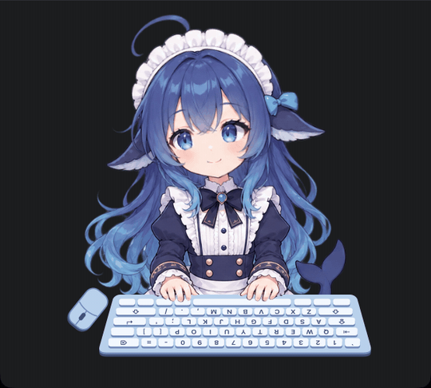
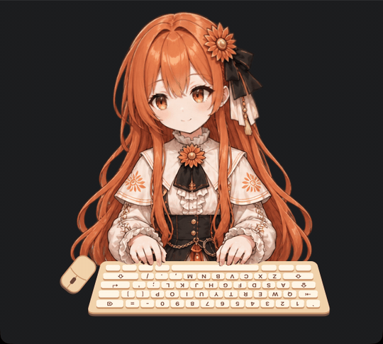
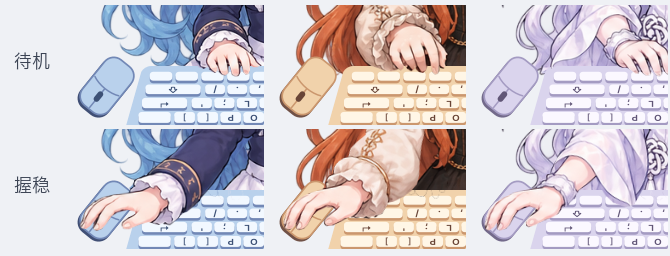

# Tricolor Desktop Pet

[简体中文](README.md) · **English**

Three desktop companions for macOS and Windows. Move your mouse and your pet follows the cursor with her eyes, then turns her head. Type a letter and she taps the matching key on her own keyboard. Give her a head pat and she smiles as little hearts float up.

## Download 1.4.0

| Platform | Download |
| --- | --- |
| macOS 12 or later, Apple silicon and Intel | [Universal macOS ZIP](https://github.com/Gaoyuan-0423/tricolor-desktop-pet/releases/download/v1.4.0/TricolorPet-1.4.0-macOS-universal.zip) |
| Windows x64 | [Windows EXE](https://github.com/Gaoyuan-0423/tricolor-desktop-pet/releases/download/v1.4.0/TricolorPet-1.4.0-Windows-x64.exe) |
| Source code | [1.4.0 source ZIP](https://github.com/Gaoyuan-0423/tricolor-desktop-pet/releases/download/v1.4.0/TricolorPet-1.4.0-source.zip) |

The macOS 1.4.0 app is signed with Developer ID and notarized by Apple. The notarization ticket is stapled to the app. The extracted app passed Gatekeeper verification. [Release notes and SHA-256 checksums](https://github.com/Gaoyuan-0423/tricolor-desktop-pet/releases/tag/v1.4.0)

## New interactions in 1.4.0

After about 45 seconds without keyboard or mouse input, DeepSeek picks up a bowl of rice, Claude opens her flower-embossed book and turns the pages, and Codex tosses a little blue cloud into the air and catches it. Their expressions change with each activity. At about 60 seconds they close their eyes and drift off. The first keystroke wakes them with a little shake and lights up the matching key. The animation below uses frames drawn by the Mac app with the idle wait shortened.


Moving the desktop cursor slides the pet’s mouse and the hand holding it together. Press D, F or Space at the same time and the other hand can still type. Hold the pet’s head for about 0.35 seconds and she’ll squint and nuzzle toward your pointer.

## The three pets at rest

The blue-haired maid, orange-haired companion and white-haired dragon appear from left to right. Click any pet for a full-size view.

<p align="center">
  <a href="docs/images/idle-blue.png"></a>
  <a href="docs/images/idle-amber.png"></a>
  <a href="docs/images/idle-frost.png"></a>
</p>

## In the app

### From mouse to keyboard

Each pet moves her hand from the mouse to the keyboard and taps D, F and J. After a head pat, she taps the keys again while smiling. These frames use the macOS renderer with the same input sequence for all three pets. The keystrokes play back more slowly so you can see the contact.


### Following the cursor

The three recordings follow the same order, with one Mac preview per pet. As the cursor moves from one side of the window to the other, her eyes shift first and her head turns a moment later.

<p align="center">
  <a href="docs/images/gaze-blue.gif"></a>
  <a href="docs/images/gaze-amber.gif"></a>
  <a href="docs/images/gaze-frost.gif"></a>
</p>

[Compare left and right stills for all three pets, with close-ups of their eyes](docs/images/cursor-tracking.png)

### Head pats

Since 1.3.0, pets have responded to a tap on the head with a little smile, followed by closed eyes and floating hearts. Keep stroking to prolong the smile. She can still type or hold the mouse while smiling.


### Holding the mouse

The columns below show the blue, orange and white characters. The top row shows their hands at rest. The bottom row shows each character holding the mouse. Version 1.3.0 introduced the wrist lift when switching between the mouse and keyboard. During fast typing she taps successive keys directly and draws her fingers back when you stop.



## Getting started

- **Mac** — Download the universal macOS ZIP, extract it, move `三色桌宠.app` into Applications, then open it. To make your pet respond while you type in other apps, right-click her, choose “开启输入监控…” (Open Input Monitoring), and allow access in System Settings.
- **Windows** — Save the Windows x64 EXE in a folder where you plan to keep it, then run it.
- **Both platforms** — Drag your pet to move her. Right-click to switch characters, mute or unmute typing sounds, or change her size from 50% to 200%.
- **Launch at login (since 1.3.0)** — Right-click your pet and select “登录时启动” to launch her the next time you sign in to this account. The option is off by default. Click it again to turn it off. If macOS asks for approval, the same menu can open Login Items in System Settings.

## Build from source

Start in the repository root. The macOS build requires the Xcode Command Line Tools. The Windows build requires Go.

**macOS**

```sh
cd BlackCat
bash build-mac.sh
```

**Windows x64 (PowerShell)**

```powershell
cd BlackCat/windows
$env:GOARCH = 'amd64'
go build -trimpath -ldflags='-s -w -H=windowsgui' -o TricolorPet.exe main.go
```

The [project guide](BlackCat/项目说明.md) covers cross-compilation and animation export. The [artwork notes](BlackCat/Artwork/素材说明.md) describe the source illustrations, hand poses and expressions. Both guides are in Chinese.
