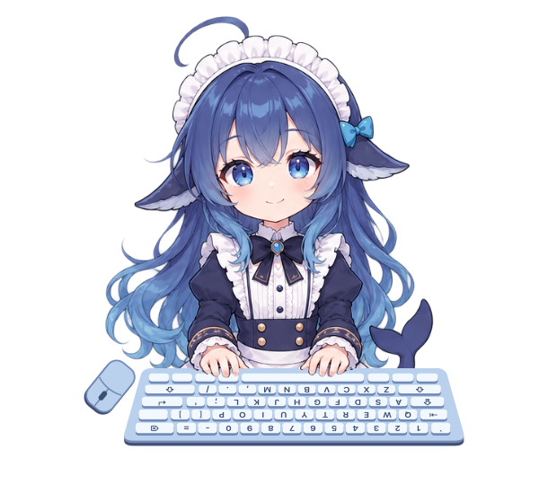
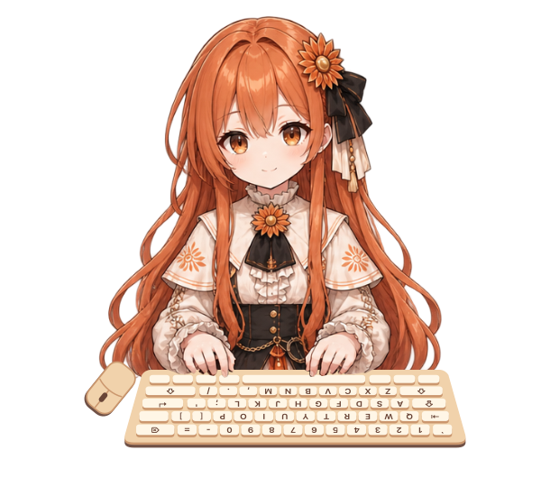
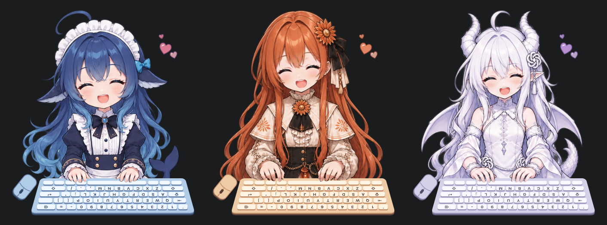

# Tricolor Desktop Pet

[简体中文](README.md) · **English**

Three desktop companions for macOS and Windows. Move your mouse and your pet follows the cursor with her eyes, then turns her head. Type a letter and she taps the matching key on her own keyboard. Give her a head pat and she smiles as little hearts float up.

[Download v1.2.0 · macOS / Windows / source](https://github.com/Gaoyuan-0423/tricolor-desktop-pet/releases/tag/v1.2.0)

## The three pets at rest

The blue-haired maid, orange-haired companion and white-haired dragon appear from left to right. Click any pet for a full-size view.

<p align="center">
  <a href="docs/images/idle-blue.png"></a>
  <a href="docs/images/idle-amber.png"></a>
  <a href="docs/images/idle-frost.png"></a>
</p>

## In the app

### Following the cursor

The three recordings follow the same order, with one Mac preview per pet. As the cursor moves from one side of the window to the other, her eyes shift first and her head turns a moment later.

<p align="center">
  <a href="docs/images/gaze-blue.gif"></a>
  <a href="docs/images/gaze-amber.gif"></a>
  <a href="docs/images/gaze-frost.gif"></a>
</p>

[Compare left and right stills for all three pets, with close-ups of their eyes](docs/images/cursor-tracking.png)

### Head pats

Click the top of a pet's head or gently stroke it back and forth. She closes her eyes and smiles as little hearts float above her.



### Holding the mouse

The columns below show the blue, orange and white characters. The top row shows their hands at rest. The bottom row shows how each character's right hand settles over the mouse buttons.


## Getting started

- **Mac** — Download the universal macOS ZIP, extract it and open `三色桌宠.app`. To make your pet respond while you type in other apps, right-click her, choose “开启输入监控…” (Open Input Monitoring), and allow access in System Settings.
- **Windows** — Download the Windows x64 EXE and run it.
- **Both platforms** — Drag your pet to move her. Right-click to switch characters, mute or unmute typing sounds, or change her size from 50% to 200%.

## Build from source

Start in the repository root. The macOS build requires the Xcode Command Line Tools. The Windows build requires Go.

**macOS**

```sh
cd BlackCat
bash build-mac.sh
```

**Windows x64 (PowerShell)**

```powershell
cd BlackCat/windows
$env:GOARCH = 'amd64'
go build -trimpath -ldflags='-s -w -H=windowsgui' -o TricolorPet.exe main.go
```

The [project guide](BlackCat/项目说明.md) covers cross-compilation and animation export. The [artwork notes](BlackCat/Artwork/素材说明.md) describe the source illustrations, hand poses and expressions. Both guides are in Chinese.
