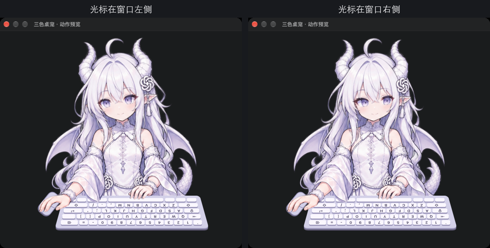
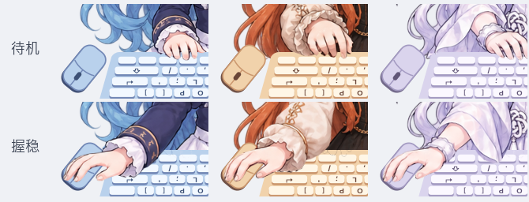

# 三色桌宠

**简体中文** · [English](README.en.md)

适用于 macOS 和 Windows 的键鼠桌宠，有三个角色可选。你移动鼠标时，她的目光会先看过去，头部随后转动。你敲键时，她会伸手按下对应的键。轻点她的头，她会微笑，头顶还会飘出小爱心。

[下载 v1.2.0 · macOS / Windows / 源码](https://github.com/Gaoyuan-0423/tricolor-desktop-pet/releases/tag/v1.2.0)

## 桌宠实际画面

下面是白色角色在 Mac 上的两个画面。左图中，光标在窗口左侧。右图中，光标移到了右侧。可以对照她的瞳孔和头部朝向。



从左到右是蓝、橙、白三个角色。上排是双手待机，下排是右手握稳鼠标时的姿势。



## 运行与操作

- **Mac**　下载 macOS 通用版，解压后打开「三色桌宠.app」。要让角色跟随其他应用里的按键，右键角色，点「开启输入监控…」并在系统设置中授权。
- **Windows**　下载 Windows x64 版，直接运行 EXE。
- **两个平台**　左键拖动可以移动角色。右键菜单可以切换角色、开关打字声，或将大小调到 50% 至 200%。

## 从源码构建

在仓库根目录打开终端。macOS 需要 Xcode 命令行工具，Windows 需要 Go。

**macOS**

```sh
cd BlackCat
bash build-mac.sh
```

**Windows x64（PowerShell）**

```powershell
cd BlackCat/windows
$env:GOARCH = 'amd64'
go build -trimpath -ldflags='-s -w -H=windowsgui' -o TricolorPet.exe main.go
```

交叉编译和动作导出的步骤见[项目说明](BlackCat/项目说明.md)。角色原画、手部标注与表情素材见[素材说明](BlackCat/Artwork/素材说明.md)。
